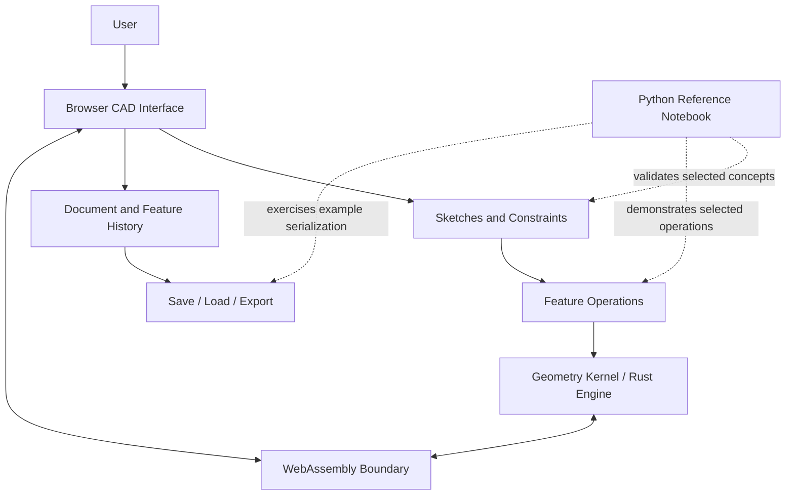
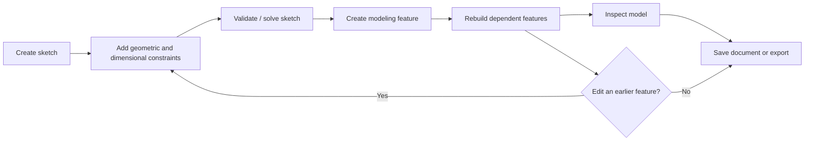
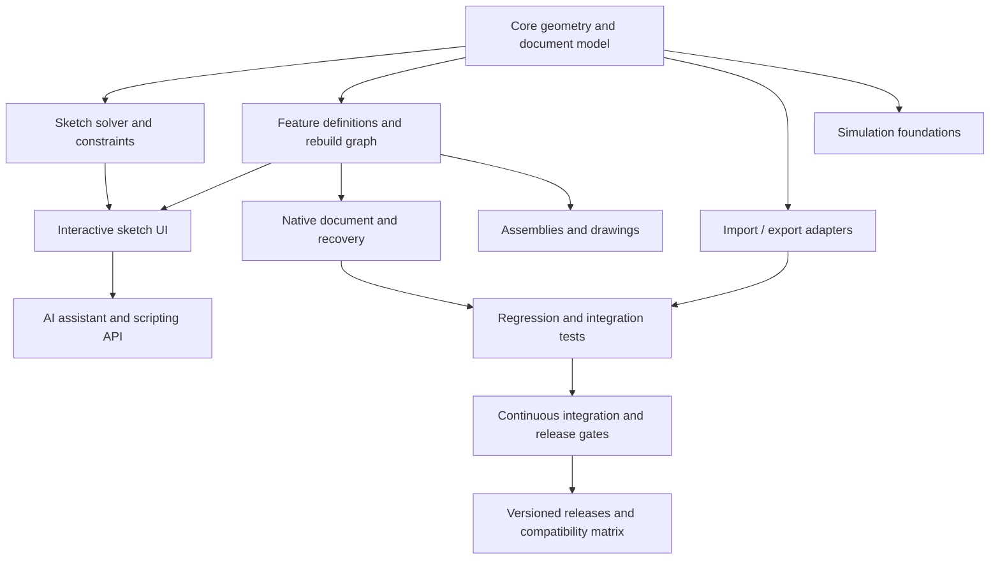
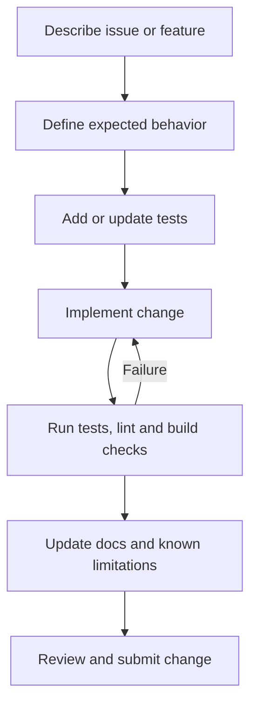

# CADmium — Parametric CAD Engineering Prototype

<p align="center">
  <strong>An experimental roadmap and reference prototype for browser-oriented parametric 3D CAD.</strong>
</p>

> **Project status:** Experimental. The accompanying Python notebook is a reference prototype and implementation roadmap. It is **not** evidence that these features are already integrated into CADmium's production Rust/WebAssembly application. Features listed as planned remain planned until implemented and tested in the main application.

---

## Table of contents

- [Project overview](#project-overview)
- [Goals](#goals)
- [Feature status](#feature-status)
- [Architecture](#architecture)
- [Parametric modeling workflow](#parametric-modeling-workflow)
- [Prototype modules](#prototype-modules)
- [Complete feature roadmap](#complete-feature-roadmap)
- [Engineering quality and acceptance criteria](#engineering-quality-and-acceptance-criteria)
- [Notebook quick start](#notebook-quick-start)
- [Development workflow](#development-workflow)
- [Testing strategy](#testing-strategy)
- [Repository structure](#repository-structure)
- [Known limitations](#known-limitations)
- [Security and privacy](#security-and-privacy)
- [Contributing](#contributing)
- [License](#license)

## Project overview

CADmium is the subject of an engineering exploration focused on the foundations of a parametric CAD workflow: constraint-based sketches, solid-modeling features, editable feature history, and project import/export. The reference notebook helps make selected ideas executable and testable before they are integrated into the primary application.

### Project goals

- Explore a small set of sketch constraints and solver behavior.
- Demonstrate profile-based extrusion and a revolution preview.
- Demonstrate feature creation, editing, rebuilds, and snapshot-based undo/redo.
- Exercise example JSON serialization and SVG/STL/OBJ exports.
- Define a staged path from a reference prototype to a robust, testable CAD application.
- Keep implemented functionality, prototype demonstrations, and future plans clearly distinguished.

### Suggested GitHub metadata

| Field | Suggested value |
|---|---|
| Repository name | `cadmium-parametric-cad` |
| Description | Experimental parametric CAD engineering prototype exploring sketch constraints, solid modeling, feature history, and project export workflows. |
| Topics | `cad`, `parametric-cad`, `3d-modeling`, `engineering`, `rust`, `webassembly`, `sveltekit`, `threejs`, `testing` |

## Goals

| Goal | Intended outcome | Evidence required |
|---|---|---|
| Sketch correctness | Predictable constraints and solver results | Unit tests, constraint status, degree-of-freedom checks |
| Modeling correctness | Valid geometry and repeatable operations | Geometry fixtures, topology checks, regression tests |
| Editable history | Reliable dependency-aware rebuilds | Edit/rebuild tests and undo/redo tests |
| Interoperability | Explicit, validated file formats | Round-trip tests and independent file validation |
| Production integration | Features connected to the main application | Rust/WASM/UI integration tests |
| Release quality | Reproducible builds and clear documentation | CI results, release checklist, known-issues list |

## Feature status

The table describes the **reference notebook and roadmap**, not a claim that the complete CADmium application currently provides every listed feature.

| Area | Reference prototype | Planned production capability | Status |
|---|---|---|---|
| Sketch constraints | Basic constraint examples and numerical solver experiment | Robust solver, conflict reporting, units and UI | Prototype / extend |
| Solid modeling | Polygon-profile extrusion, limited profile operations, revolution preview | Robust topology and general 3D operations | Limited prototype |
| Feature history | Add/edit/rebuild and snapshot-based undo/redo example | Dependency graph, stable IDs and persistence | Prototype / extend |
| Save/load | Versioned example JSON | Native schema, migrations, recovery and compatibility | Example only |
| Export | SVG profile and STL/OBJ mesh examples | Validated format support, including STEP only if implemented | Partial prototype |
| Test automation | Notebook regression checks | Main-repository unit, integration and CI tests | Planned |
| Browser integration | Architecture target only | Rust/WASM engine connected to the UI | Not established by notebook |

## Architecture

The following diagram shows the **intended conceptual architecture**. It is not a verified map of every module currently present in the repository.



### Suggested subsystem boundaries

| Subsystem | Responsibilities | Key engineering concerns |
|---|---|---|
| User interface | Sketching, selection, property editing, model view | Responsiveness, accessibility, clear errors |
| Sketch system | Geometry entities, constraints, solver interface | Units, tolerances, under/over-constraint handling |
| Geometry engine | Curves, surfaces, solids and topology | Robustness, invalid geometry, deterministic results |
| Feature system | Feature definitions, dependencies and rebuild | Stable references, recompute order, failure recovery |
| Document layer | Native document, metadata, versions and history | Schema validation, migrations, safe loading |
| Interchange layer | Import and export adapters | Format conformance, units, coordinate systems |
| Test infrastructure | Unit, integration, regression and benchmark tests | Reproducibility and failure diagnosis |

## Parametric modeling workflow



A production implementation should make each step's status visible and preserve the document if an operation fails. Failed rebuilds should report the failing feature and avoid silently corrupting downstream geometry.

## Prototype modules

The companion notebook demonstrates selected behavior in Python. These examples are useful for exploration but should not be treated as a substitute for integration with the main application's Rust/WebAssembly code.

| Module | Demonstrated scope | Important gaps |
|---|---|---|
| Parametric Sketching Engine | Horizontal, vertical, coincident, fixed-point, length and equal-length examples; least-squares solver experiment; plots and regression checks | Robust constraint solver, degrees of freedom, conflict diagnosis, tolerance strategy, units, production UI |
| Solid Modeling Operations | Polygon-profile extrusion, limited same-height 2D profile operations and revolution preview | General 3D Boolean operations, robust topology, broad profile validation, kernel integration |
| Feature History and Editing | Add/edit/rebuild and snapshot-based undo/redo examples | Dependency-aware recompute, stable feature identity, durable history and document integration |
| Save, Load and Export | Versioned JSON example, SVG profile output, STL/OBJ mesh export examples | Native CADmium format compatibility, schema migration, broad import support, STEP export |

## Complete feature roadmap

Roadmap items below are proposed work. Mark an item complete only after implementation, tests, and documentation provide evidence.

### Phase P0 — Core CAD correctness

- [x] Demonstrate basic sketch constraints and solver checks in the reference notebook.
- [x] Demonstrate profile extrusion and a revolution preview.
- [x] Demonstrate feature edit/rebuild and snapshot-based undo/redo.
- [x] Demonstrate example JSON round-trip and SVG/STL/OBJ export workflows.
- [ ] Define supported geometry, input limits, units and tolerance behavior.
- [ ] Add reproducible regression fixtures for valid and invalid inputs.
- [ ] Port validated concepts into the primary application and its test runner.

### Phase P1 — Production integration

- [ ] Map prototype concepts to the existing Rust geometry types and APIs.
- [ ] Define stable data models for sketches, constraints, features and documents.
- [ ] Integrate the engine through the Rust/WebAssembly boundary.
- [ ] Connect sketch creation, constraint editing, feature properties and errors to the browser UI.
- [ ] Add end-to-end tests for sketch → feature → rebuild → save/load.
- [ ] Report unsatisfied constraints and failed operations with actionable messages.

### Phase P2 — Modeling and interoperability

| Workstream | Planned capabilities | Acceptance evidence |
|---|---|---|
| Sketch tools | Lines, arcs, circles, rectangles, construction/reference geometry, trim and offset | Tool-level tests and interaction tests |
| Constraints | Dimensional/geometric constraints, solver status, degrees of freedom, conflict detection | Deterministic solver tests and documented tolerances |
| Modeling | Extrude, revolve, transforms, datum geometry, patterns, mirror, multi-body workflows | Geometry fixtures and validity checks |
| Inspection | Measure tools, clipping/section views, appearance and mass properties | Known-shape comparisons and unit tests |
| Feature history | Dependency graph, stable references, rebuild ordering, durable undo/redo | Edit-earlier-feature and recovery tests |
| File lifecycle | Versioned native schema, migration, autosave and crash recovery | Round-trip, migration and recovery tests |
| Interchange | Evaluate formats such as STL, 3MF, DXF, STEP, IGES and OBJ | Per-format conformance and independent-reader checks |
| Assemblies | Components, mates, collision/interference checks, exploded views and BOM | Assembly fixtures and collision tests |
| Drawings | Orthographic views, dimensions, tolerances, title blocks, PDF/SVG/DXF output | Drawing fixtures and output validation |

**Format note:** A format appearing in this roadmap is not a claim of current support. STEP/IGES and other formats may require a suitable geometry kernel or dedicated library and license review.

### Phase P3 — Engineering, extensibility and professional platform

| Workstream | Planned capabilities | Guardrails / validation |
|---|---|---|
| Simulation foundations | Material records, mesh pipeline, load/boundary-condition definitions and initial FEA workflow | Benchmark against known problems; clearly label unverified results |
| Advanced simulation | Thermal analysis and, later, CFD exploration | Independent validation, numerical verification and explicit scope limits |
| AI assistant | Natural-language commands, model explanation and guided workflows | Typed allow-listed commands, preview-before-apply, confirmation for destructive actions, undo and audit trail |
| Scripting/plugins | Documented command API and extension points | Permissions, API versioning, isolated failures and compatibility tests |
| UX/accessibility | Keyboard workflows, accessible labels, useful errors and internationalization | Accessibility review and interaction tests |
| Performance | Profiling, background work, caching and large-model benchmarks | Published benchmark fixtures and performance budgets |
| Reliability | Crash recovery, fuzz testing, malformed-file tests and diagnostics | Reproducible crash/bug tests and recovery validation |
| Security/privacy | Input validation, dependency review, safe file parsing and optional telemetry controls | Threat review, dependency scanning and documented data handling |
| Collaboration | Optional cloud sync, sharing permissions, revisions and conflict handling | Authentication/authorization tests and conflict-resolution tests |
| Release engineering | CI, reproducible builds, packaging, versioning and release notes | Green CI, clean-install checks and documented support matrix |
| Governance | Contribution rules, issue templates, capability matrix and license review | Maintainer review and explicit licensing information |

### Cross-cutting implementation dependencies



## Engineering quality and acceptance criteria

A roadmap feature is not complete just because a demo runs. Use the following release gate for each substantial feature:

1. **Specification:** Supported inputs, units, tolerances, expected outputs and known failure cases are documented.
2. **Implementation:** The feature is integrated into the intended application subsystem, not only shown in a separate notebook.
3. **Tests:** Unit and regression tests cover normal cases, edge cases and invalid inputs.
4. **Integration:** Relevant UI, document, engine and serialization boundaries are tested together.
5. **Reliability:** Failure does not silently corrupt the document; errors identify the failed operation.
6. **Documentation:** Usage, limitations, compatibility and examples are updated.
7. **Release evidence:** CI passes and any required performance or interoperability checks are recorded.

## Notebook quick start

The notebook can be run in Google Colab or a compatible local Jupyter environment.

1. Open [Google Colab](https://colab.research.google.com/).
2. Choose **File → Upload notebook**.
3. Upload `CADmium_All_Features_Complete_Notebook.ipynb` if that file has been committed to this repository, or upload it directly from your computer.
4. Choose **Runtime → Run all**.
5. Review the output cells, regression checks, export examples and roadmap sections.

Once the notebook is committed to GitHub, create a direct Colab link using this pattern and replace the placeholders:

```text
https://colab.research.google.com/github/OWNER/REPOSITORY/blob/main/CADmium_All_Features_Complete_Notebook.ipynb
```

Do not publish a direct link until the notebook exists at that exact repository path.

## Development workflow

Use the original CADmium repository's own setup and contribution instructions for the main application. The Python notebook is a separate reference environment and may have different dependencies.

Suggested change workflow:



Before proposing a change:

- Explain the behavior added or fixed.
- Add a small reproducible test or model where appropriate.
- Record limitations and known failure cases.
- Avoid claiming production support until the main application implements and tests it.
- Check dependency and license compatibility before adding libraries.

## Testing strategy

| Test layer | Examples | Purpose |
|---|---|---|
| Unit tests | Constraint equations, geometry helpers, serialization validators | Catch local logic errors |
| Solver tests | Fully constrained, under-constrained, over-constrained and conflicting sketches | Verify solver behavior and diagnostics |
| Geometry tests | Valid/invalid profiles, extrusion, topology and Boolean edge cases | Protect geometric correctness |
| History tests | Edit earlier feature, rebuild descendants, undo/redo and failed rebuild | Protect parametric dependencies |
| File tests | Save/load round-trip, old schema migration, malformed or oversized input | Protect document integrity and safe parsing |
| Interoperability tests | Export and import through independent tools where available | Check format validity and unit/coordinate consistency |
| Integration tests | Browser UI ↔ WASM ↔ engine ↔ document | Verify subsystem boundaries |
| Performance tests | Large sketches, feature trees and meshes | Detect regressions with repeatable benchmarks |
| CI/release checks | Formatting, lint, tests, build, dependency scan and packaging | Keep releases reproducible |

## Repository structure

The exact file layout depends on the checked-out repository. A suggested organization for future work is:

```text
cadmium-parametric-cad/
├── README.md
├── docs/
│   ├── architecture.md
│   ├── feature-roadmap.md
│   ├── testing-strategy.md
│   └── formats-and-limitations.md
├── notebooks/
│   └── CADmium_All_Features_Complete_Notebook.ipynb
├── tests/
│   ├── fixtures/
│   ├── geometry/
│   ├── history/
│   └── serialization/
└── .github/
    ├── ISSUE_TEMPLATE/
    └── workflows/
```

> This is a **suggested target structure**, not a statement that these directories already exist in the source repository.

## Known limitations

- The notebook is a Python reference prototype separate from the main Rust/WebAssembly application.
- Profile Boolean operations in the prototype are limited and are not general-purpose 3D solid Boolean operations.
- Revolution is a prototype/preview workflow.
- The example JSON format is not claimed to match CADmium's native project format.
- STEP export is not implemented in the reference notebook.
- A passing notebook check does not establish production-grade geometric robustness.
- Roadmap entries are proposed work until the implementation, tests and documentation demonstrate otherwise.

## Security and privacy

For future file import, scripting, plugin and AI-command features:

- Validate file size, structure, version and numeric values before processing.
- Treat imported files and plugin inputs as untrusted data.
- Avoid arbitrary code execution from model files or natural-language instructions.
- Use allow-listed, typed CAD operations for automation.
- Preview edits and require confirmation for destructive or hard-to-reverse operations.
- Keep dependency versions and license obligations documented.
- Make any telemetry explicit, minimal and controllable by the user.

## Contributing

Bug reports are most useful when they include:

- Operating system, runtime and relevant dependency versions.
- Exact steps to reproduce the issue.
- Expected behavior and actual behavior.
- Error output or logs with secrets removed.
- A small sketch/model fixture that reproduces the problem, if safe to share.

For feature proposals, describe the user problem, intended behavior, acceptance tests, compatibility impact and known trade-offs before implementation.

## License

Confirm the license that applies to the original CADmium project and any modifications before distributing this repository. Verify dependency licenses and attribution requirements; do not assume a license that has not been checked in the source repository.

---

*Documentation principle: clearly distinguish implemented code, notebook demonstrations, proposed architecture and future roadmap items.*
